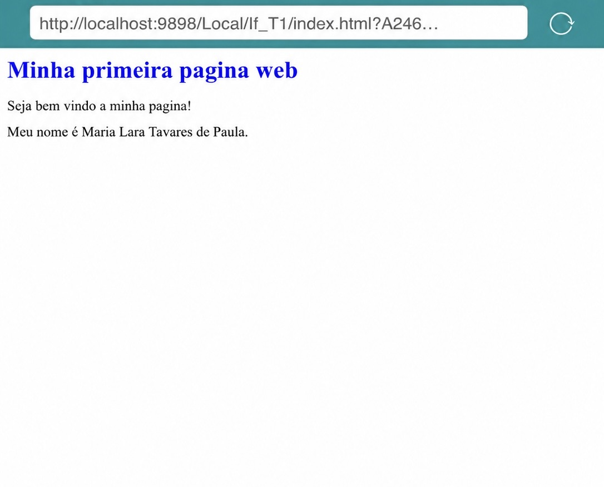

# Minha primeira página Web

## Sobre a atividade
Esta é minha primeira página desenvolvida na disciplina Programação Web I.

## Tecnologias utilizadas
- HTML
- GitHub

## Evidências da atividade
1. Página HTML criada e funcionando.
2. Alteração visual temporária pelas DevTools.
3. Repositório com o primeiro commit realizado.

